<p align="center">
  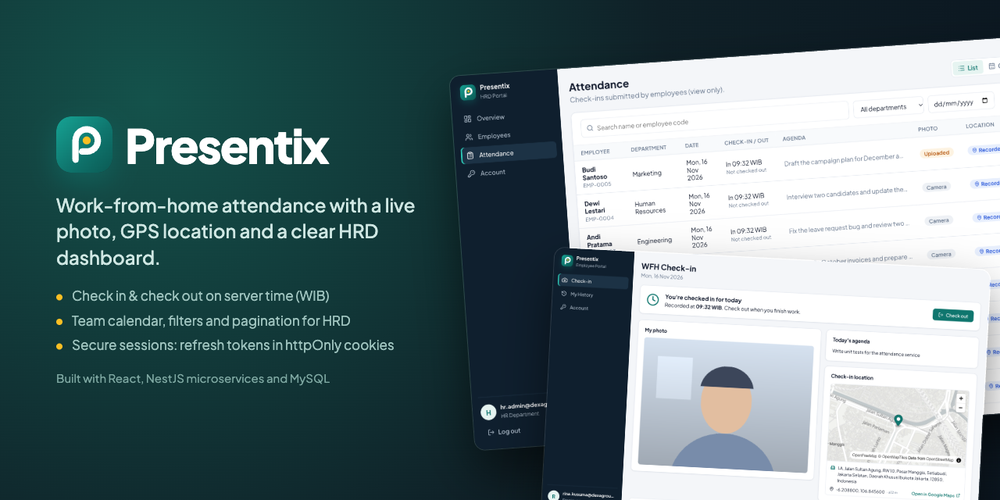
</p>

<h1 align="center">Presentix</h1>

<p align="center">
  Work-from-home attendance: employees check in and out with a live photo and GPS location,<br>
  HRD manages employees and monitors attendance.
</p>

<p align="center">
  <a href="https://github.com/rigelra15/presentix/actions/workflows/ci.yml"></a>
  
  
  
  
  
</p>

The name comes from **presence**: every check-in proves an employee is present, with a live photo and their location.

## Contents

- [Highlights](#highlights)
- [Tech stack](#tech-stack) · [Architecture](#architecture)
- [Setup](#setup) · [Running the app](#running-the-app)
- [Features](#features) · [Pages](#pages)
- [API](#api) · [Database](#database) · [Configuration](#configuration)
- [Security notes](#security-notes) · [Design decisions](#design-decisions)
- [Known limitations and next steps](#known-limitations-and-next-steps)
- [Screenshots](#screenshots)

## Highlights

| | |
| --- | --- |
| 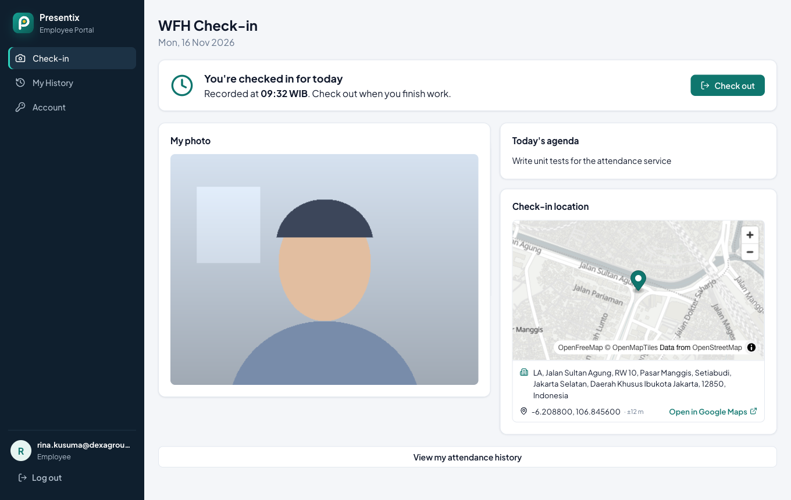 | **Check in and check out.** GPS location, a live camera photo and today's agenda. The server sets the time (WIB), one check-in per day. Check out at the end of the day to record work hours. |
| 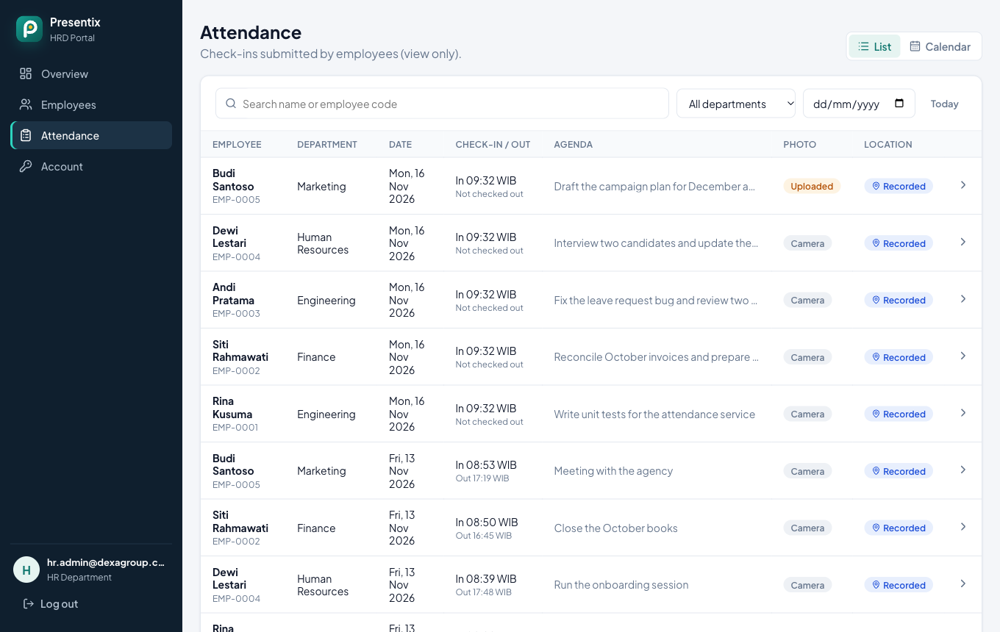 | **HRD monitoring.** Search, filter by department and date, check-in / check-out times, pagination, and a team calendar. |
| 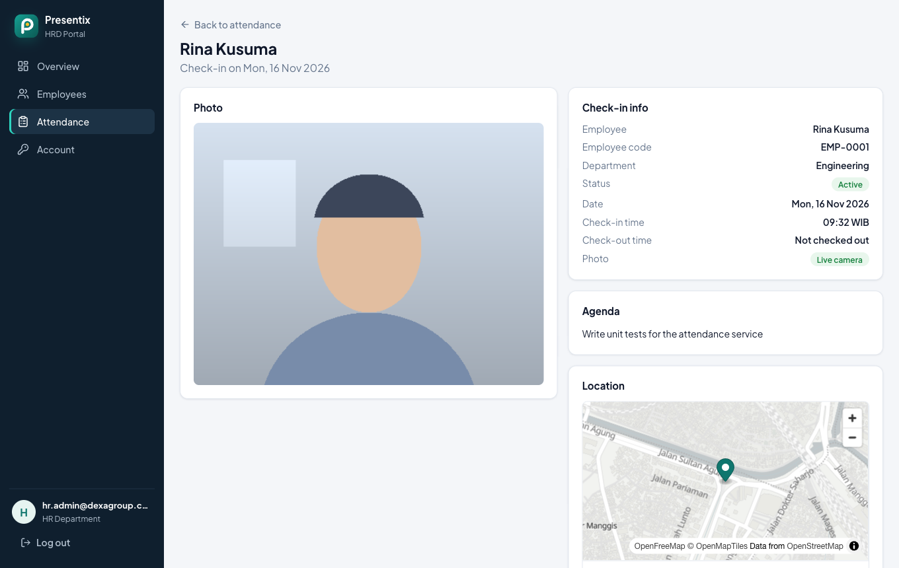 | **Proof per check-in.** Photo, agenda, map with street address, work duration and how the photo was taken. |
| 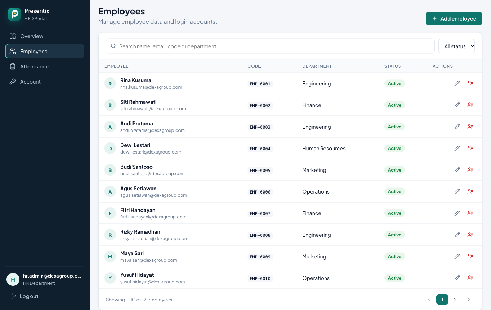 | **Employee management.** Add, edit, deactivate, reactivate and delete. The employee code and work email are filled in automatically. |
| 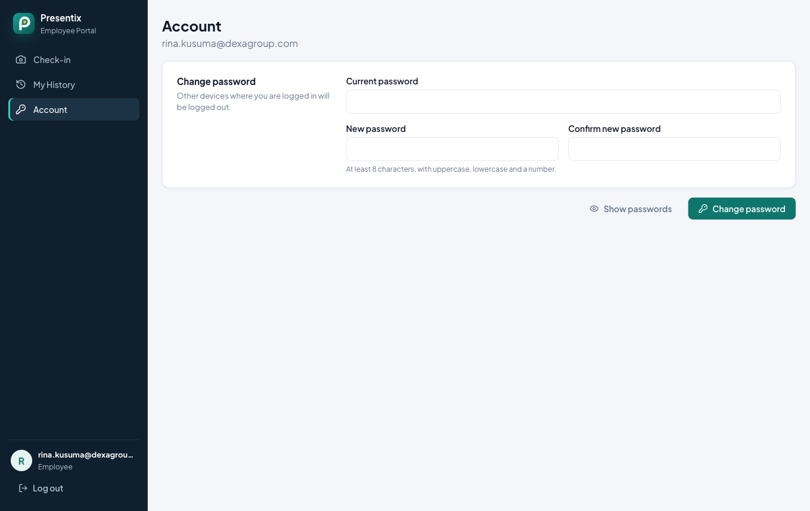 | **Secure sessions.** Short-lived access token in memory, rotating refresh token in an httpOnly cookie, server-side logout and change password. |

## Tech stack

- **Frontend:** React + TypeScript + Vite, React Router, MapLibre GL JS, lucide icons (`apps/web`)
- **Backend:** 2 NestJS services (TypeScript)
  - `apps/employee-service` – login, refresh token, logout, change password, employee master data
  - `apps/attendance-service` – check-in (photo + GPS), check-out, attendance history
- **Database:** MySQL 8.4 (Docker), TypeORM migrations
- **Password hashing:** Argon2id
- **API docs:** Swagger (OpenAPI) on both services
- **Docker:** the whole app (MySQL, both services, nginx + web) runs with one command
- **CI:** GitHub Actions runs lint, unit tests, build and the Docker build

## Architecture

```
            ┌──────────────┐
 Browser ──>│  web (Vite)  │  :5173
            └──────┬───────┘
     /api/employee │   /api/attendance
         ┌─────────┴──────────┐
         v                    v
 ┌──────────────────┐   ┌────────────────────┐
 │ employee-service │<──│ attendance-service │
 │      :3000       │   │       :3001        │
 └────────┬─────────┘   └─────────┬──────────┘
          v                       v
     employee_db             attendance_db      (MySQL :3307)
```

- Each service has its **own database and DB user**. A service cannot read the
  other service's tables.
- `employee-service` issues the JWT. `attendance-service` checks the token by
  calling `GET /auth/me` on `employee-service`, so a deactivated employee is
  blocked immediately in both services.
- The Vite dev server proxies `/api/employee/*` and `/api/attendance/*` to the
  services, so the browser only talks to one origin (no CORS setup needed).

## Quick start with Docker

Only Docker Desktop (with Compose v2) is needed. This is the easiest way to try the app.

```bash
# 1. Create the secret files (random DB passwords and JWT secret) in docker/secrets/
node scripts/setup-secrets.mjs
#    No Node.js installed? Run the same script inside Docker:
#    docker run --rm -v "$PWD":/app -w /app -u "$(id -u):$(id -g)" node:22-alpine node scripts/setup-secrets.mjs

# 2. Build and start MySQL, both services and the web app
docker compose --profile app up -d --build --wait

# 3. Create the demo HRD and employee accounts
docker compose run --rm seed
```

Open **http://localhost:8080** and log in with an account from
`docker/secrets/demo-accounts.json`. To create your own HRD account instead of
the demo accounts, run `docker compose run --rm seed npm run create-hrd`.

| What                | URL                                     |
| ------------------- | --------------------------------------- |
| Web app             | http://localhost:8080                   |
| Employee API docs   | http://localhost:8080/api/employee/docs |
| Attendance API docs | http://localhost:8080/api/attendance/docs |

Stop it with `docker compose --profile app down` (data is kept). With npm the
same commands are `npm run stack:up`, `npm run stack:seed` and `npm run stack:down`.

How it works:

- nginx (in the `web` container) serves the built React app and forwards
  `/api/employee/*` and `/api/attendance/*` to the services, like the Vite
  proxy does in development. Only port 8080 is opened, on `127.0.0.1`.
- Each service runs its new migrations when it starts.
- The services wait until MySQL is healthy, and the web app waits until both
  services answer `GET /health`.
- The app services use the `app` profile, so `npm run db:up` (plain
  `docker compose up`) still starts only MySQL for local development. Both ways
  use the same database and the same photo folder.

## Local development setup

### Requirements

- Node.js 24 LTS (or 22.22.3+) and npm
- Docker Desktop (with Docker Compose v2)

### Setup

```bash
npm install
npm run setup
```

`npm run setup` does these steps in order:

1. `setup:secrets` – creates random passwords and the JWT secret in
   `docker/secrets/` (this folder is git-ignored; existing files are kept)
2. `db:up` – starts MySQL with Docker and waits until it is healthy.
   On first start, `docker/mysql/init.sh` creates both databases and DB users
3. `build` – builds all apps
4. `migrate` – runs the TypeORM migrations for both services

After this the database is empty. Create accounts with **one** of these options.

#### Option A – demo accounts (quick try)

```bash
npm run seed
```

Creates one HRD and one employee account (for example
`hrd.demo@dexagroup.com`). The passwords are generated randomly and saved in `docker/secrets/demo-accounts.json`. Open that
file to see them.

#### Option B – real accounts (empty database)

There is no public sign-up page, so the first HRD account is created from the
terminal:

```bash
npm run create-hrd
```

The script asks for an email and a password (hidden while typing) and saves
the password as an Argon2id hash.

Password rule (same for HRD and employees): at least 8 characters, with an
uppercase letter, a lowercase letter and a number.

Then log in as that HRD and add employees from the **Employee Management**
page. Each employee gets their own login account (email + password set by HRD).

### Running the app

Open 3 terminals in the project root:

```bash
npm run dev:employee     # http://localhost:3000
npm run dev:attendance   # http://localhost:3001
npm run dev:web          # http://localhost:5173
```

Then open http://localhost:5173 and log in with a demo account or the HRD account you created.

Optional check that login works with the demo accounts (employee service must be running):

```bash
npm run check:login
```

## Features

**Employee**
- Login
- WFH check-in in 3 steps:
  1. **GPS location** from the browser (required, the API rejects a check-in
     without valid coordinates)
  2. **Live photo** taken with the device camera. Only if the camera cannot
     be used (no camera, permission denied, old browser) the employee can
     upload a JPEG/PNG file instead. HRD sees which way was used
     ("Live camera" or "Uploaded file")
  3. **Today's agenda**: a short note (3–500 characters) about what the
     employee works on today. HRD can read it
- Date and time are taken from the server, not from the browser
- Only one check-in per day (Asia/Jakarta date). This is also enforced by a
  unique index in the database
- After check-in, the employee sees their own photo, agenda and location
- **Check-out** at the end of the day (once, after confirming in a modal).
  The page then shows the check-in time, check-out time and hours worked
- Attendance history, with a detail page for each check-in (photo, agenda, map)
- Monthly calendar: checked-in days are green, missed work days red,
  weekends grey (see "Attendance calendar" below)

**Everyone**
- **Account** page to change the password (current password required).
  Other devices where the user is logged in are logged out
- Logging out also ends the session on the server

**HRD**
- Overview: active employees, who checked in today (with their agenda), and who has not
- Add, view, and update employees. On "Add employee" the next free code
  (`EMP-0001`, `EMP-0002`, ...) is filled in automatically, and the work email
  is made from the full name (`Budi Santoso` → `budi.santoso@dexagroup.com`).
  Both can still be changed
- Employee and attendance lists are split into pages (10 / 20 rows), and go
  back to page 1 when a filter changes
- Deactivate / reactivate employees, and permanently delete an employee that
  has no attendance (see "Delete" below). Every one of these actions asks for
  confirmation in a modal first
- Monitor all attendance: search by name or code, filter by department and date.
  The list shows check-in and check-out time ("Not checked out" until then)
- Calendar view: per day, how many employees checked in (e.g. `2/3`), or
  checked in / absent for one selected employee. Click a day to open it
- Attendance detail: photo, check-in / check-out time, work duration, agenda and a map of the location
  (MapLibre GL JS with the free OpenFreeMap Positron style, no API key needed,
  plus a link to Google Maps)
- Every map also shows the street address of the coordinates (reverse
  geocoding, see below)

### Pages

| URL                       | Who      | Page                               |
| ------------------------- | -------- | ---------------------------------- |
| `/login`                  | everyone | Sign in                            |
| `/check-in`               | Employee | Today's check-in                   |
| `/history`                | Employee | My attendance history              |
| `/history/:id`            | Employee | My check-in detail (photo + map)   |
| `/hrd`                    | HRD      | Overview                           |
| `/hrd/employees`          | HRD      | Employee list                      |
| `/hrd/employees/new`      | HRD      | Add employee                       |
| `/hrd/employees/:id/edit` | HRD      | Edit employee                      |
| `/hrd/attendance`         | HRD      | Attendance list with filters       |
| `/hrd/attendance/:id`     | HRD      | Attendance detail (photo + map)    |
| `/account`                | everyone | Change password                    |

### Login session

- `POST /auth/login` returns a short **access token** (JWT, 15 minutes) in the
  JSON body and sets a **refresh token** in an `httpOnly`, `SameSite=Strict`
  cookie (7 days).
- The web app keeps the access token **only in memory** (not in
  `localStorage` / `sessionStorage`), so a script injected into the page cannot
  steal a long-lived token.
- When a request gets `401`, the app calls `POST /auth/refresh` once and
  repeats the request. Requests that fail at the same time share one refresh.
- After a page reload the session is restored the same way.
- Every refresh **rotates** the token: the old one stops working. If an old
  token is used again, it was probably copied, so all sessions of that user
  are ended.
- Only a SHA-256 hash of each refresh token is stored (`refresh_tokens` table).

### Camera and GPS notes

- Browsers only allow camera and GPS on `https://` or `http://localhost`.
  To try it on a phone in the same network, the web app must be served over
  HTTPS (opening `http://<laptop-ip>:5173` will block the camera).
- Live photos and GPS make cheating harder for normal users, but a
  determined user could still use a virtual camera or a fake GPS app. The
  server records its own time and stores the GPS accuracy so HRD can spot
  unusual check-ins. Stronger checks (e.g. office geofencing, face matching)
  are out of scope for this project.

### Attendance calendar

A day counts as **absent** when it is a past work day (Monday–Friday) with no
check-in. Days before the employee's account was created are not counted, and
today only becomes absent after it is over. Public holidays are not known by
the app, so they show as absent if nobody checks in.

In the HRD team view, the expected employees for a day are the currently
active employees who already existed on that day (status changes are not
kept as history).

### Address lookup (reverse geocoding)

The address under each map comes from the free OpenStreetMap
[Nominatim](https://nominatim.org/) API, called from the browser
(`apps/web/src/lib/geocode.ts`). No API key is needed. Its usage policy
allows about 1 request per second, so:

- the address is only looked up where a map is shown (not in tables)
- results are cached in memory, so the same coordinates are asked only once

The address is not stored in the database. If the lookup fails, only the
coordinates are shown. Note that this sends the check-in coordinates to
OpenStreetMap's server.

### Deactivate vs. permanent delete

`DELETE /employees/:id` sets `is_active = false` instead of removing the row.
Attendance records point to the employee, so hard-deleting an employee would
leave attendance history without an owner. A deactivated employee cannot log
in, and HRD can reactivate them later. This is the normal way to "remove" an
employee.

`DELETE /employees/:id/permanent` really removes the employee and their login
account. It is meant for accounts created by mistake, so it is only allowed when:

1. the employee is already deactivated (so they cannot check in while being
   deleted), and
2. they have **no** attendance records. employee-service asks
   attendance-service (`GET /attendances?employeeId=<id>`, with the HRD's
   token). If attendance-service cannot be reached, nothing is deleted.

## API

Interactive API docs (Swagger UI), where you can also try the endpoints:

- Local development: http://localhost:3000/docs and http://localhost:3001/docs
- Docker: http://localhost:8080/api/employee/docs and http://localhost:8080/api/attendance/docs

The OpenAPI file is at `/docs-json`. Click **Authorize** and paste the
`access_token` from `POST /auth/login` to call the protected endpoints.

All endpoints except login, refresh and logout need `Authorization: Bearer <token>`.

Both services also have `GET /health` (no token needed). It returns
`{ "status": "ok" }` when the service is running and its database answers,
or `503` when the database cannot be reached.

### employee-service (:3000)

| Method | Path             | Role | Description                    |
| ------ | ---------------- | ---- | ------------------------------ |
| POST   | `/auth/login`    | –    | Login, returns JWT (15 min) + refresh cookie. Max 5 tries per minute |
| POST   | `/auth/refresh`  | cookie | New access token + new refresh cookie |
| POST   | `/auth/logout`   | cookie | Ends the session, clears the cookie |
| POST   | `/auth/change-password` | any | `{ currentPassword, newPassword }`, logs out other devices |
| GET    | `/auth/me`       | any  | Current user                   |
| GET    | `/employees`     | HRD  | List employees                 |
| GET    | `/employees/next-code` | HRD | Next free code, e.g. `EMP-0002` |
| GET    | `/employees/:id` | HRD  | Employee detail                |
| POST   | `/employees`     | HRD  | Create employee + login account |
| PATCH  | `/employees/:id` | HRD  | Update / reactivate employee   |
| DELETE | `/employees/:id` | HRD  | Deactivate employee            |
| DELETE | `/employees/:id/permanent` | HRD | Delete employee for good (see above) |

### attendance-service (:3001)

| Method | Path                     | Role            | Description                         |
| ------ | ------------------------ | --------------- | ----------------------------------- |
| POST   | `/attendances`           | EMPLOYEE        | Check in (multipart, see below)     |
| POST   | `/attendances/me/check-out` | EMPLOYEE     | Check out for today (once)          |
| GET    | `/attendances/me`        | EMPLOYEE        | Own attendance history              |
| GET    | `/attendances`           | HRD             | All attendance (`?employeeId=` filter) |
| GET    | `/attendances/:id`       | HRD / owner     | Attendance detail                   |
| GET    | `/attendances/:id/photo` | HRD / owner     | Check-in photo                      |

`POST /attendances` is `multipart/form-data` with these fields:

| Field       | Rules                              |
| ----------- | ---------------------------------- |
| `latitude`  | number, -90 to 90                  |
| `longitude` | number, -180 to 180                |
| `accuracy`  | number in meters, from the browser |
| `note`      | text, 3 to 500 characters          |
| `photoSource` | `CAMERA` or `UPLOAD` (label set by the browser) |
| `photo`     | JPEG or PNG, max 5 MB              |

## Database

**employee_db**
- `users` – id, email (unique), password_hash, role (`EMPLOYEE` / `HRD`), created_at
- `employees` – id, user_id (unique, FK → users), employee_code (unique),
  full_name, department, is_active
- `refresh_tokens` – id, user_id (FK → users, cascade), token_hash (unique,
  SHA-256), expires_at, revoked_at, created_at

**attendance_db**
- `attendances` – id, employee_id, attendance_date, checked_in_at, checked_out_at, photo_path,
  photo_source, latitude, longitude, location_accuracy, note, created_at.
  Unique index on (employee_id, attendance_date).
  The location, note, photo_source and checked_out_at columns were added by later migrations
  and are empty for check-ins made before them.

`employee_id` has no foreign key because it lives in another service's
database. Photos are saved on disk in `storage/attendance-photos/` (git-ignored),
and only the file name is stored in the database.

## Useful commands

```bash
npm run build      # build all apps
npm run lint       # lint all apps
npm test           # unit tests (backend: login, refresh tokens, change password, employee codes, delete rules, check-in / check-out)
npm run db:down    # stop MySQL (data is kept in the Docker volume)
npm run stack:up   # Docker: build and start everything (http://localhost:8080)
npm run stack:down # Docker: stop everything (data is kept)
```

Every push to `main` runs the same lint, test and build steps in GitHub
Actions (`.github/workflows/ci.yml`), plus a check that the Docker images build.

Check migration status for one service:

```bash
npm run migration:show -w employee-service
```

## Configuration

Defaults work for local development. These environment variables can override them:

| Variable                | Used by            | Default                                    |
| ----------------------- | ------------------ | ------------------------------------------ |
| `MYSQL_PORT`            | docker compose     | `3307`                                     |
| `PORT`                  | both services      | `3000` (employee), `3001` (attendance)     |
| `DB_HOST` / `DB_PORT`   | both services      | `127.0.0.1` / `3307`                       |
| `DB_PASSWORD_FILE`      | both services      | `docker/secrets/<service>_db_password`     |
| `JWT_SECRET_FILE`       | employee-service   | `docker/secrets/jwt_access_secret`         |
| `EMPLOYEE_SERVICE_URL`  | attendance-service | `http://127.0.0.1:3000`                    |
| `ATTENDANCE_SERVICE_URL` | employee-service  | `http://127.0.0.1:3001`                    |
| `ATTENDANCE_PHOTO_DIR`  | attendance-service | `storage/attendance-photos`                |
| `EMPLOYEE_API_URL`      | web (Vite proxy)   | `http://127.0.0.1:3000`                    |
| `ATTENDANCE_API_URL`    | web (Vite proxy)   | `http://127.0.0.1:3001`                    |
| `API_BASE_PATH`         | both services      | `/` (Swagger "Try it out" path, `/api/...` in Docker) |
| `COOKIE_SECURE`         | employee-service   | `false` (set `true` when served over HTTPS) |
| `WEB_PORT`              | docker compose     | `8080`                                     |
| `PHOTO_DIR`             | docker compose     | `./storage/attendance-photos`              |

## Security notes

- Passwords are hashed with Argon2id. The hash column is never returned by the API.
- Login allows 5 attempts per minute for the same email from the same IP address,
  then answers `429 Too Many Requests`. This slows down password guessing.
- A wrong email and a wrong password get the same error, and take about the same
  time (an unknown email is still checked against a dummy hash), so the login
  does not reveal which emails exist.
- Sessions: 15-minute access token kept in memory, refresh token in an
  httpOnly `SameSite=Strict` cookie, stored hashed, rotated on every use, with
  reuse detection. Logout and password change end sessions on the server.
- Changing the password needs the current password and is rate limited per user.
- Secrets are read from files in `docker/secrets/`, not hard-coded or committed.
- MySQL is only exposed on `127.0.0.1`.
- Each service uses its own DB user that only has access to its own database.
- Uploaded photos are checked by their file signature (not only the extension),
  saved with a random file name, and can only be viewed with a valid token.
- In Docker the services run as a normal user (not root), and nginx adds
  basic security headers (`X-Frame-Options`, `X-Content-Type-Options`, ...).

## Design decisions

- **Two services that call each other over HTTP**, not an API gateway or a
  message broker. attendance-service checks every token with
  `GET /auth/me`, so a deactivated employee is blocked at once. This keeps
  the code small and easy to follow for the size of this project.
- **One web app with two portals** (employee and HRD). The role from the
  token decides which pages are shown, and the API checks the role again on
  every request.
- **Server time only.** The check-in date and time are set by the server in
  Asia/Jakarta time, so changing the phone clock does not help.
- **Deactivate instead of delete**, so attendance history keeps its owner.
  Permanent delete exists only for accounts without attendance.
- **Photos on disk, not in the database**, with random file names. They can
  only be loaded through the API with a valid token.

## Known limitations and next steps

- No shifts or late rules yet. One check-in and one check-out per day.
- Public holidays are not known, so the calendar shows them as absent.
- An access token that was already issued stays valid until it expires
  (max 15 minutes), even after logout or a password change.
- There is no "forgot password" flow (it needs email sending), and HRD
  cannot reset an employee's password from the UI yet.
- Camera and GPS come from the browser, so a virtual camera or a fake GPS app
  can still be used. Uploaded photos keep their EXIF metadata.
- Photos are stored on the local disk. A real deployment would use object
  storage (for example S3) and HTTPS in front of nginx.
- The login rate limit is kept in memory, so it resets when the service restarts.

## Screenshots

The data in these screenshots is demo data, and the photos are placeholders.

| | |
| --- | --- |
| 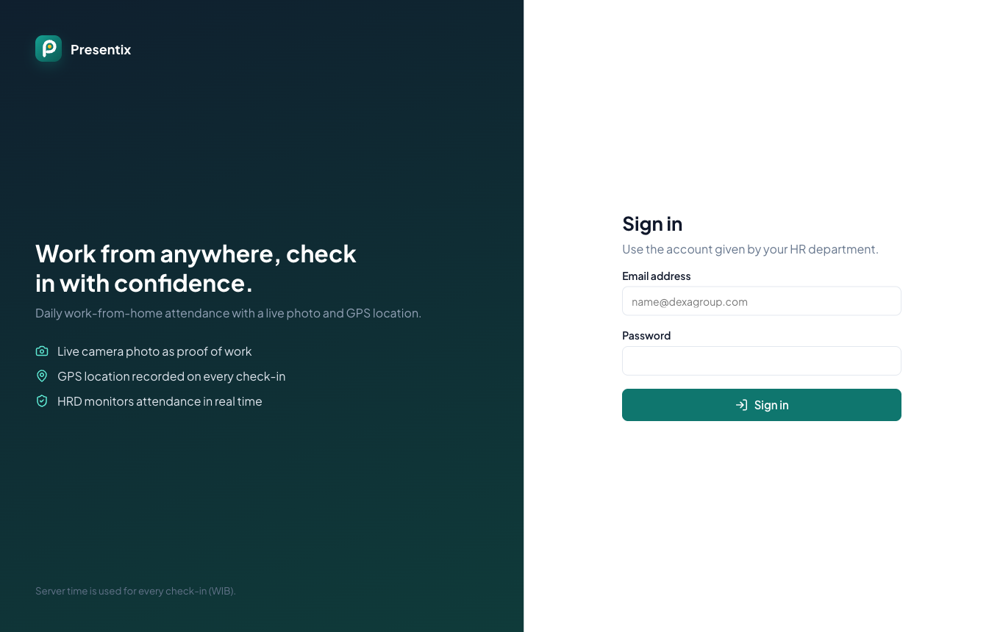 Login |  Employee: today's check-in |
| 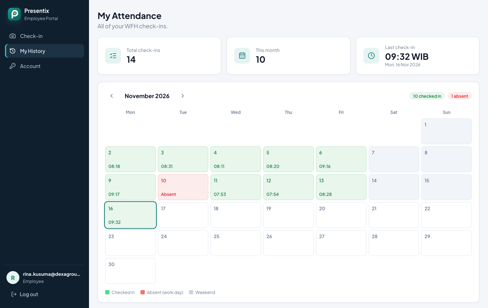 Employee: attendance calendar | 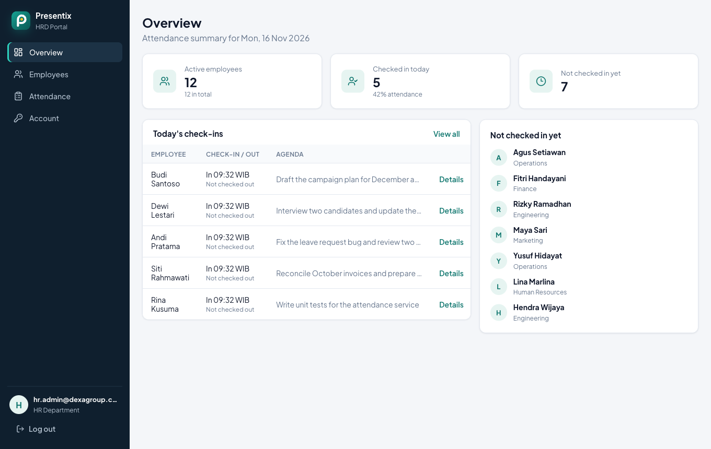 HRD: overview |
|  HRD: employees |  HRD: attendance list |
| 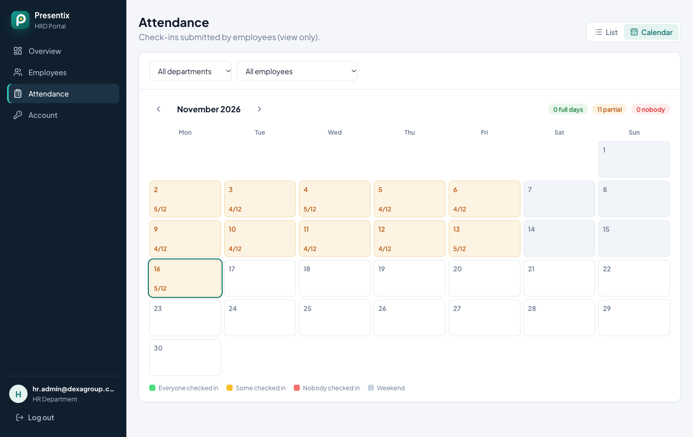 HRD: team calendar |  HRD: attendance detail |
|  Account: change password | 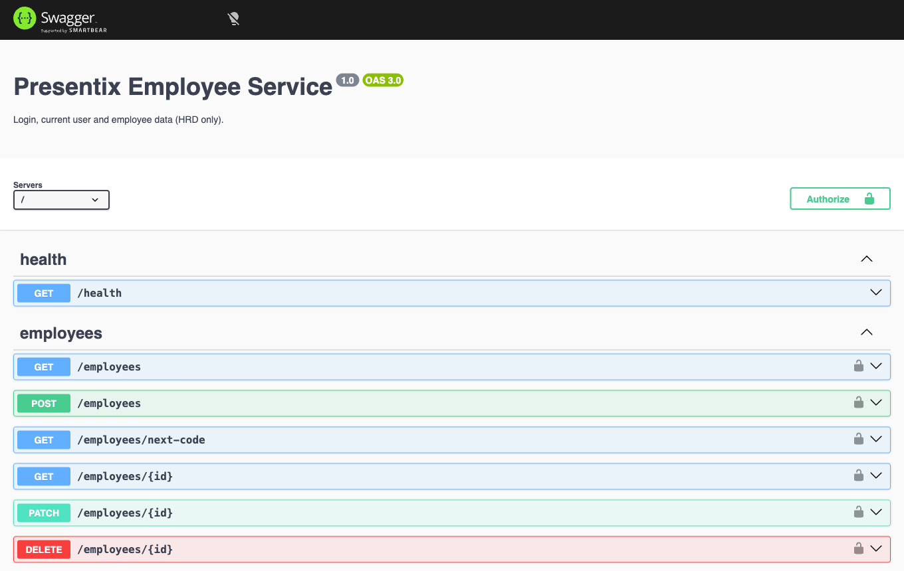 API docs (Swagger) |
